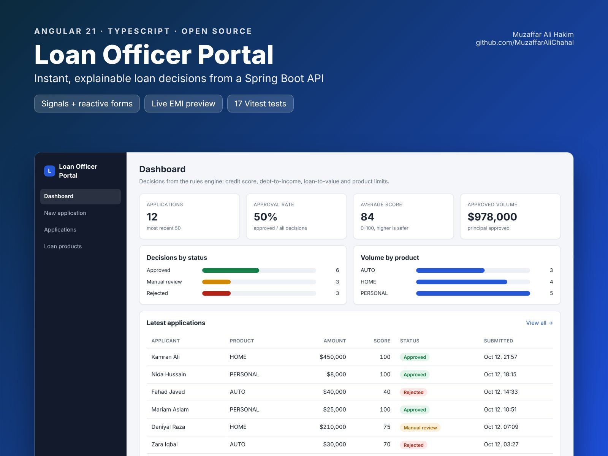

# Loan Officer Portal (Angular)


   

An Angular 21 front end for my Spring Boot [loan-assessment-api](https://github.com/MuzaffarAliChahal/loan-assessment-api).
Loan officers submit applications, get an instant decision with the reason for every rule, and track decisions on a dashboard.

**Live demo:** https://muzaffaralichahal.github.io/angular-loan-officer-portal/ (runs in your browser with sample data, no backend needed)



## Features

- **Dashboard:** approval rate, average score, approved volume, decisions by status and by product
- **New application:** reactive form with validation, live monthly payment (EMI) preview, and the decision with a rule-by-rule explanation (credit score, debt-to-income, loan-to-value, product limits)
- **Applications:** search and status filter (status filtering is done by the API), click through to a detail page
- **Loan products:** rates, limits and collateral rules served by `GET /api/v1/products`
- **API errors shown per field:** RFC 7807 `ProblemDetail` responses from Spring Boot map onto the form fields

## How it's built

| Concern | Approach |
| --- | --- |
| Components | Standalone components, new control flow (`@if`, `@for`), lazy-loaded routes |
| State | Signals and `computed()`; RxJS for HTTP, `toSignal` / `toObservable` to bridge them |
| Forms | Typed reactive forms (`FormBuilder.nonNullable`) with server-side errors merged in |
| API layer | An abstract `LoanApi` with two implementations: `HttpLoanApi` (HttpClient) and `DemoLoanApi` (in-browser), chosen by environment |
| Routing | `withComponentInputBinding()` binds `:id` straight to a component input |
| Tests | 17 Vitest tests: scoring rules (same numbers as the Java tests), the demo API, and the form component |

```
src/app/
├── core/
│   ├── models.ts        # mirrors the API's DTOs
│   ├── loan-api.ts      # LoanApi + HTTP and demo implementations
│   └── scoring.ts       # browser copy of the decision rules
├── pages/               # dashboard, apply, applications, application-detail, products
└── shared/              # status badge
```

## Run it

```bash
npm install
npm start                          # demo mode at http://localhost:4200
npm test                           # unit tests
```

Against the real API (start [loan-assessment-api](https://github.com/MuzaffarAliChahal/loan-assessment-api) on port 8080 first):

```bash
npx ng serve --configuration live  # proxies /api to http://localhost:8080
```

## Deployment

GitHub Actions runs the tests, builds with the right `--base-href`, and publishes the demo to GitHub Pages on every push to `main`.

## License

MIT
